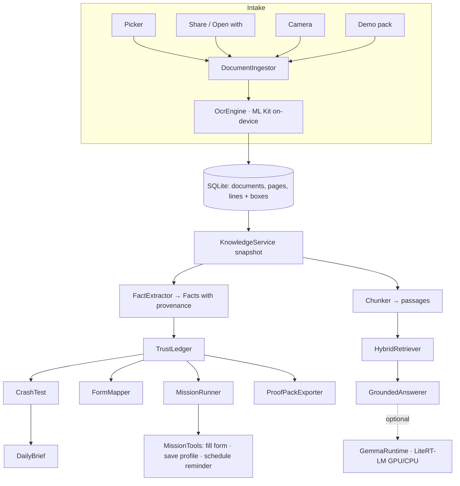
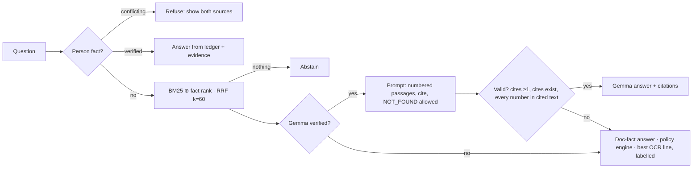
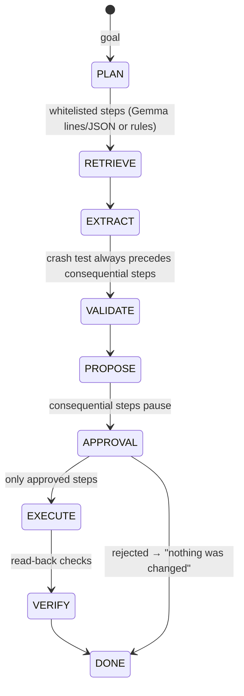

# Architecture

Kaagaz is a single-module Android app in Kotlin with no network permission. Its design rule: **a language model may interpret evidence, but deterministic code decides what is true, what is shown, and what is executed.**

## Package map

```
com.kaagaz.app
├── core        OCR data model (pages, lines, boxes), ClauseAssembler (sentences from wrapped OCR lines)
├── ocr         OcrEngine (ML Kit, blocking), DocumentIngestor (one intake pipeline), DemoPack
├── insurance   InsuranceExtractor, CoverageIntelligenceEngine, DocumentQaEngine, DocumentProfile  [pre-existing]
├── knowledge   Facts.kt (FactType, FactExtractor, Normalizer, DocKind), TrustLedger
├── audit       CrashTest: findings with severity, evidence, next action
├── forms       FormSpec, FieldIdentifier (labels → fact types, sensitive-field flags), FormMapper
├── rag         Chunker, HybridRetriever (BM25 + fact signal, RRF), GroundedAnswerer (validation)
├── llm         LlmClient seam, GemmaRuntime (LiteRT-LM), Services
├── mission     MissionPlanner (whitelist parser), MissionRunner (state machine), MissionTools seam
├── brief       DailyBrief: urgency-ranked "what needs you today"
├── proof       ProofPackExporter: cited, fingerprinted PDF
├── data        KaagazStore (SQLite v4), KnowledgeService (snapshot, user decisions, vault, tools)
├── reminders   ReminderPolicy, ReminderScheduler, ReminderWorker (WorkManager)            [pre-existing, extended]
└── ui          MissionActivity (Mission OS), DocumentActivity (document workspace), DesignSystem
```

Everything outside `ui`, `data`, `ocr`, `llm/GemmaRuntime`, `proof` and `reminders` is plain Kotlin and covered by JVM unit tests. Android types are reached through small seams: `LlmClient`, `MissionTools` and `boxOf`.

## Layers



The **snapshot is derived, not stored**. Facts, chunks and the ledger are recomputed from saved OCR text whenever documents change. Only **user decisions** are persisted: resolutions, corrections, finding states, missions, form values and the encrypted profile. So improving an extractor improves every existing document without a migration.

## Grounded answering



The validator lives in `GroundedAnswerer.validate`. It is why the screenshot of Gemma saying "12" for 312 ends with the correct quoted line.

## Mission Mode



These are the safety rails, and `MissionPlanner.enforce` applies them whoever planned:
- **Whitelist only.** Unknown actions, wrong argument shapes, truncated JSON and arrays posing as strings are all rejected.
- **Retrieval and the ledger always run first.**
- **The Crash Test always runs before any consequential step.**
- **A form is always previewed before it is filled.**

Each consequential tool reports `verified` only after a read-back:
- **Form fill:** the stored values equal the proposed values.
- **Profile:** decrypting the vault equals what was written.
- **Reminder:** the reminder row is read back, and WorkManager enqueueing succeeded.

## Gemma runtime

- **Library:** LiteRT-LM Android **0.16.1**. 0.17 and later need a Kotlin 2.4 compiler, and AGP 9.0.1 bundles Kotlin 2.2.
- **Loading:** the model is user-imported, never bundled or downloaded, and copied into app-private storage. Loading tries the GPU, then the CPU, and the model is marked **VERIFIED** only after a real generation returns text.
- **Crash guard:** a native abort can't be caught in Kotlin. A `.loading` marker written before initialisation turns a model that killed the app into **FAILED** on the next launch, so it never retries in a loop. Files under 100 MB are rejected at import.
- **Runtime limits:** generation runs on a dedicated thread, with timeout and cancellation (`Conversation.cancelProcess`), plus out-of-memory handling.

## Storage

| Table | Holds |
|---|---|
| `documents`, `ocr_pages`, `ocr_lines` | Imported files, OCR text, line boxes and confidence |
| `insurance_fields`, `field_evidence` | Pre-existing insurance extraction with user edits |
| `fact_resolutions`, `fact_corrections` | User choices on conflicts; corrections keep the original source |
| `finding_states` | Resolved or dismissed crash-test findings |
| `missions`, `form_values` | Mission history; filled and typed form values with their source |
| `reminders` | Deadline reminders (policy expiry and bill due) |
| `files/profile.enc` | AES-256-GCM, key in the Android Keystore |

## Threading and robustness

- **No UI blocking.** Every snapshot build, OCR, model call and export runs on executors, and the UI re-renders on completion.
- **Mission planning can't fail outright.** Any exception falls back to the rule-based planner, and the reason is shown on screen.
- **Reminders survive upgrades.** They are re-enqueued once per app version, so pending work always targets the current worker class.
- **Bad provider types are handled.** If a sender's provider reports no MIME type, intake falls back to the declared type, then the file name.
