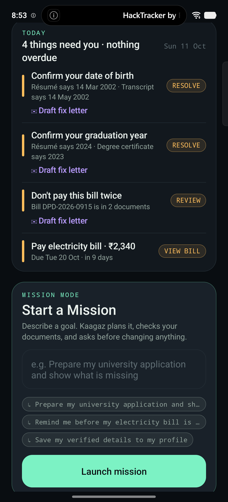
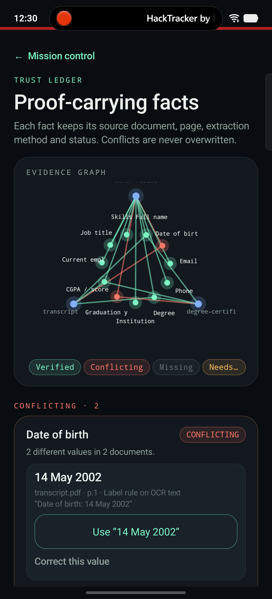
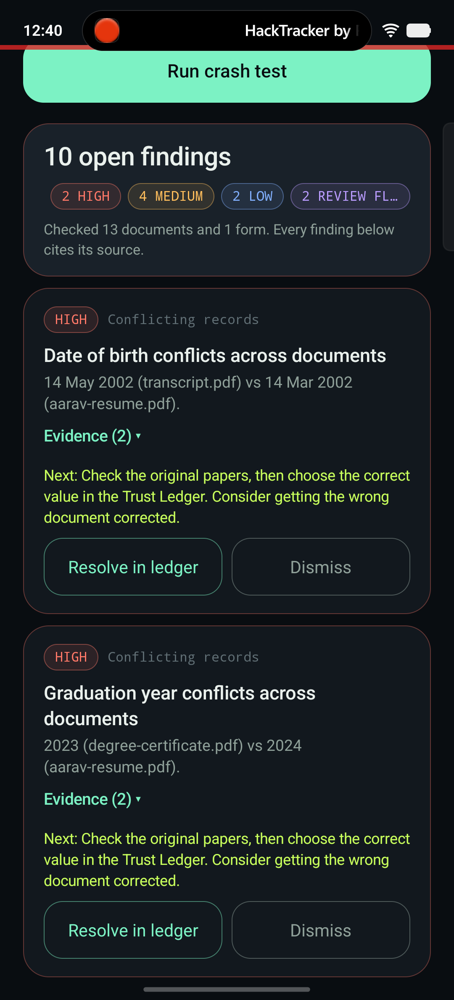
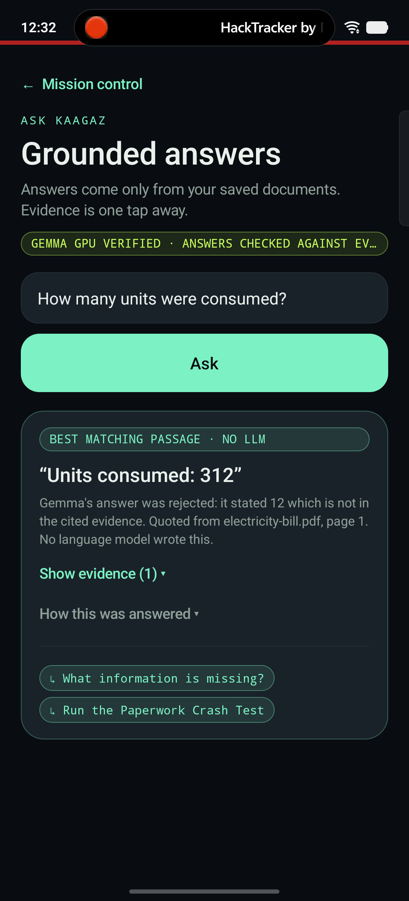

# Kaagaz — Mission OS

**Your life, documented. Your paperwork, handled.**

Kaagaz is a privacy-first Android agent that turns personal documents into **verified knowledge** and **approved real-world actions**, running entirely on the phone with on-device **Gemma**.

Its core idea is **proof-carrying AI**:
- Every important fact and proposed form value carries its source document, page and quoted text.
- Conflicts and gaps stay visible instead of being smoothed over.
- Nothing consequential happens without the user's approval.

| Home & Today's Brief | Trust Ledger | Paperwork Crash Test | Gemma caught out |
|---|---|---|---|
|  |  |  |  |

> The last screenshot shows the app working as intended. On-device Gemma answered "12" when the bill says **312**. Kaagaz caught the number missing from the cited evidence, rejected the answer, and showed the exact line instead.

---

## Why it's different

| Typical "chat with your PDF" | Kaagaz Mission OS |
|---|---|
| The model answers from whatever it retrieves | **Answers are validated**: every number must appear in the cited passage, answers must cite something, and conflicts are refused |
| Contradictions get averaged away | A **Trust Ledger** records VERIFIED / CONFLICTING / MISSING / NEEDS CONFIRMATION, and only the user resolves a conflict |
| Q&A only | **Paperwork Crash Test** finds conflicting records, missing facts and documents, duplicate bills, deadlines, unsupported form values and over-reaching data requests |
| The model "does things" | **Mission Mode**: the model proposes steps from a whitelist; Kotlin tools execute them only after approval, then **verify** the result |
| Data goes to the cloud | **No INTERNET permission at all.** OCR, retrieval and Gemma run on the device |
| Trust me | **Proof Pack**: a portable PDF with every fact's citation and the **SHA-256 fingerprint** of each source file |

## What it does

- **Ingest:** file picker, **Share to Kaagaz** from any app, **camera scan**, or a one-tap **fictional demo pack**. On-device ML Kit OCR keeps page numbers and line bounding boxes.
- **Understand:** document classification (résumé, certificate, transcript, bill, statement, policy). Label- and pattern-based fact extraction records provenance and OCR confidence. Normalisation means `8.4` and `8.40` agree.
- **Trust Ledger and evidence graph:** facts about the person are cross-checked across their own documents. Conflicts are drawn as red edges; the user resolves them or corrects a value, and the original source is kept.
- **Ask:** hybrid retrieval (Okapi BM25 fused with structured-fact matches by reciprocal-rank fusion), then **Gemma 3 1B on the GPU**. Every answer is checked against its evidence, and anything that fails falls back to clearly labelled deterministic answers.
- **Paperwork Crash Test:** audits a document set and, optionally, a form, with severity, evidence, next action, and resolve or dismiss.
- **Mission Mode:** PLAN → RETRIEVE → EXTRACT → VALIDATE → PROPOSE → **APPROVAL** → EXECUTE → **VERIFY**. Plans are proposed by Gemma or by rules, checked against a whitelist, and the safety steps are always enforced.
- **Smart form:** a field-by-field mapping with sources. Only verified, non-sensitive values are filled; you can paste labels from any form. Nothing is ever submitted.
- **Money and insurance:** bills, due dates, duplicates, and paid vs outstanding vs scheduled premiums. Guaranteed and projected benefits are kept separate, waiting periods and exclusions are flagged, and approved reminders use WorkManager.
- **Today's Brief:** what needs you today, ranked by urgency.
- **Privacy:** documents are kept in app-private storage, the profile is encrypted with AES-256-GCM using an Android Keystore key, backups are disabled, and nothing is logged about document contents.

## Try it in 3 minutes

1. Install `output/demo/Kaagaz-mission-os-v4.apk` on an arm64 Android 8+ phone.
2. On the home screen, tap **Install demo pack**. Five clearly labelled fictional documents go through the real OCR pipeline.
3. Follow **[docs/DEMO_SCRIPT.md](docs/DEMO_SCRIPT.md)**.

To enable Gemma, import `gemma3-1b-it-int4.litertlm` (from [litert-community/Gemma3-1B-IT](https://huggingface.co/litert-community/Gemma3-1B-IT), after accepting Google's Gemma terms) under **Privacy & model**. Without it, every feature still works and answers are labelled as rule-based.

## Build

```powershell
./gradlew.bat testDebugUnitTest assembleDebug   # JDK 17+ (Android Studio's JBR works)
```

Requires Android SDK platform 36 and build-tools 36.1.0. If the checkout lives under OneDrive, build output goes to `%LOCALAPPDATA%\kaagaz-build`, because OneDrive placeholders break Gradle.

## Documentation

| | |
|---|---|
| [Architecture](docs/ARCHITECTURE.md) | Packages, data flow, safety design, storage |
| [Demo script](docs/DEMO_SCRIPT.md) | A 3-minute judged walkthrough |
| [Judging map](docs/JUDGING.md) | Each criterion, with evidence and honest limits |
| [Testing](docs/TESTING.md) | 126 unit tests, plus an on-device verification log |
| [Attribution & originality](docs/ATTRIBUTION.md) | Libraries, models, licences, and what existed before this work |

All documents in this repository are **fictional** test fixtures.
